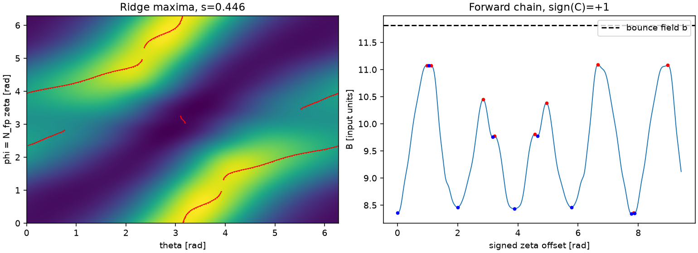
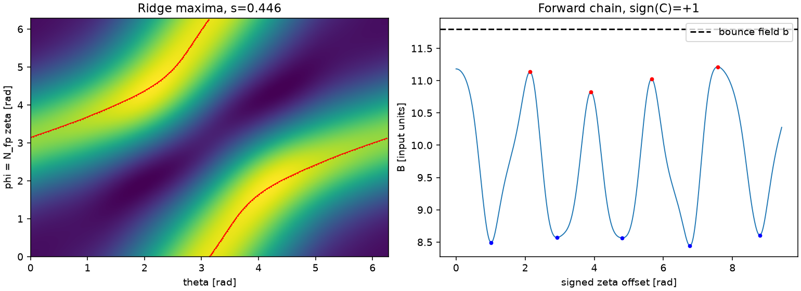
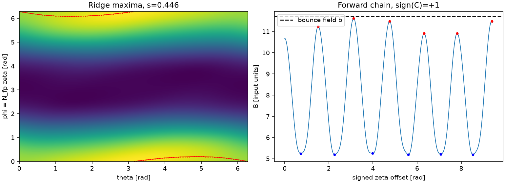
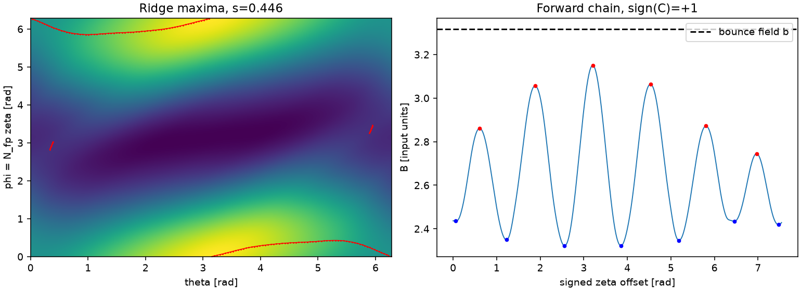
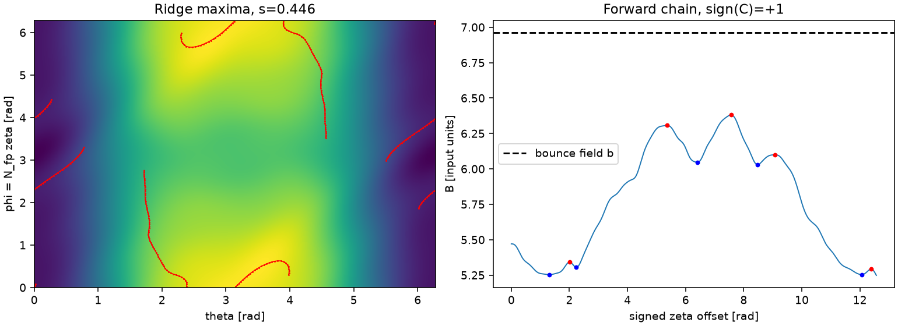

# M1 implementation evidence — incomplete

This branch builds pitch-independent field tables, ridge curves, extremum chains
and trapped-well integrals. The population ledger compares the sum of time spent
in those wells with a separate angular volume calculation. This checks whether
the geometry counts particle births once, with the right weight. It does not
compute losses or f.

M1 is **not complete**. The final matrix has no failed quadratures, but three
pitch cases contain capped wells and one further case misses the 1% ledger gate.
[ADR 0001](../../adr/0001-long-well-cap-and-m1-ledger.md) proposes a concrete next
step. The PR stays draft; M2 has not started.

## Reproduction and scope

From the repository, with the isolated environment installed:

```bash
OPENBLAS_NUM_THREADS=1 OMP_NUM_THREADS=1 MPLBACKEND=Agg \
  .venv/bin/python scripts/validate_m1.py --output outputs/m1
OPENBLAS_NUM_THREADS=1 .venv/bin/python scripts/probe_m1_long_wells.py
```

`validate_m1.py` intentionally exits nonzero while any matrix gate is unmet.
Its `test_ledger_matrix` is the named offline acceptance check. Full five-file
matrices stay outside unit CI, as AGENTS requires. The unit suite contains the
fast `test_ledger_closes` on DMercFail at two pitches and both sources.

The base run uses 24 uniformly spaced surfaces from 0.02 to 1 plus four graded
inner surfaces down to 0.001; 512² Fourier tables; 128 ridge nodes per 2pi of
arc length; 48 periods at 128 samples per period; 64 Gauss nodes per extremum
segment. The volume reference uses 512 staggered phi slices and 64 Gauss nodes
in each theta interval bounded by B=b. It shares B interpolation, but uses no
ridges, chains, K, partners, or transverse measure. No result is an error
enclosure or a statistical interval.

The M1 total is a **ridge-strip ledger**, integrated radially by the trapezoid
rule. It retains all ridge contributions, including those without radial
partners. It is not the M2 transition-cut cell ledger, and it cannot certify
cell coverage. Radial partners are stored in one direction with integer IDs;
frontier weight is reported separately. Raw interior-barrier T and Gamma counts
are diagnostics only; unresolved mismatches are listed for M2, with no claim of
transition completeness or connectivity.

## Provenance

Baseline: `a6a31fc9a2627b62ad78e01e276bdce272d13f63`, with green
[Tests run 42852585314](https://github.com/landreman/alpha_analysis_3/actions/runs/42852585314).
The new modules were uncommitted during measurements; their exact source SHA-256
hashes, controls, file hashes, radial grids, global extrema and locations,
volumes, counts and timings are in [provenance.json](provenance.json). No earlier
repository or prototype was imported by production code or tests.

The table/interpolation, periodic contour stitching and sine-substitution ideas
were ported from the prototype. Production changes include sine Fourier modes,
cubic-spline defect correction, uniform arc-length nodes, fold endpoints with
interior nodes, derivative-bracketed extrema, composite well quadrature,
bounded batches and explicit capped/failed statuses. Numerical global extrema
use 65 radial x 64² angular seeds over **s in [0,1]**, followed by exact Fourier
optimization in all three coordinates, including the axis. These estimates
match the manifest's legacy extrema and are numerical estimates, not bounds.

Host: Linux x86_64, Python 3.12.14; package versions in provenance.json. Every
equilibrium ran sequentially, one worker, one BLAS/OpenMP thread. No JIT kernels
are used, so there is no JIT or compilation cache to omit from timings. The
memory watchdog aborts above 2 GB; measured matrix peaks were below 0.44 GB.

## Failed attempts and fixes

[matrix.csv](matrix.csv) preserves all 60 source checks in the initial run,
the PCA-only fold diagnostic, and all 60 final source checks. Blank total/ratio
fields mean incomplete, not zero. Resolved contributions remain numeric so the
missing part is visible; they are not accepted totals or substitutes for unknown
weight. Raw full JSON and logs remain under ignored `outputs/` and `/tmp`.

- The first run estimated extrema on its recorded surfaces. The final run adds
  exact-series optimization over s in [0,1], including the axis; every attempt
  retains its actual b and extrema in the CSV.
- Plain cubic interpolation missed the 1e-7 relative derivative requirement at
  512². An analytic leading-defect correction using Fourier fourth derivatives
  now passes the unchanged direct-series test. Grid values remain exact FFT sums.
- A manufactured folded ridge exposed contour-grid degeneracy. Shifting both
  angular contour grids and placing open-arc nodes inside the endpoints removes
  spurious endpoint states while retaining the full transverse measure.
- Field-value differences missed a real PCA minimum before the first sample.
  Derivative brackets find it. The independent direct-series regression
  `test_shallow_first_minimum_is_not_skipped` preserves the exact failing node.
- The initial cap test expected a well with a return exactly at one period to
  remain capped. That expectation was wrong: a resolved endpoint return counts.
  The test now checks that return and separately checks a genuinely capped well.
- Confirmed PCA first returns at 73.8003 and 114.8438 periods exceed the planned
  cap. Refining sampling to 512 per period agrees on the physical exits even
  when a below-b extremum changes the chain index. Exact-series maxima and
  quadrature refinement are in [long-wells.json](long-wells.json). These diagnostic
  extensions do not change the default or complete the missing ledger weights.
- A diagnostic request for 256 periods x 512 samples hit the bounded allocation
  guard. The 512-sample comparison uses 128 periods, still covering both exits.

## Final matrix

Ratios must be within 6% for every case, and within 1% for DMercFail and d23p4,
for both sources. Capped wells make the total incomplete. No reachable fractions,
unknown-weight bracket or f are available at M1. A capped-node count cannot be
converted into an unknown-weight fraction; that value is unavailable here.

| File | lambda_n | b | Ridge / volume, h=1 | Ridge / volume, peaked | Capped nodes | Raw T / Gamma mismatched surfaces |
| --- | ---: | ---: | ---: | ---: | ---: | ---: |
| PCA | 0.05 | 7.931434564812 | 1.002534 | 1.041715 | 0 | 0 |
| PCA | 0.1 | 8.147184858801 | 1.002681 | 1.002053 | 0 | 2 |
| PCA | 0.5 | 9.873187210716 | 1.002458 | 1.006107 | 0 | 2 |
| PCA | 0.8 | 11.167688974652 | incomplete | incomplete | 1 | 2 |
| PCA | 0.9 | 11.599189562631 | 1.014626 | 1.032710 | 0 | 1 |
| PCA | 0.95 | 11.814939856621 | incomplete | incomplete | 1 | 3 |
| TURBO | 0.05 | 7.576918032940 | 0.992685 | 0.991447 | 0 | 0 |
| TURBO | 0.1 | 7.811419099418 | 0.996209 | 1.000278 | 0 | 1 |
| TURBO | 0.5 | 9.687427631245 | 0.999996 | 0.999972 | 0 | 0 |
| TURBO | 0.8 | 11.094434030115 | 1.003437 | 1.006007 | 0 | 1 |
| TURBO | 0.9 | 11.563436163072 | incomplete | incomplete | 2 | 1 |
| TURBO | 0.95 | 11.797937229550 | 0.998636 | 0.992055 | 0 | 0 |
| DMercFail | 0.05 | 5.390959775429 | 0.998435 | 0.996535 | 0 | 1 |
| DMercFail | 0.1 | 5.741453657786 | 0.999389 | 0.997311 | 0 | 0 |
| DMercFail | 0.5 | 8.545404716638 | 1.000630 | 1.001943 | 0 | 0 |
| DMercFail | 0.8 | 10.648368010778 | 0.999844 | 0.999620 | 0 | 0 |
| DMercFail | 0.9 | 11.349355775491 | 1.001434 | 1.005249 | 0 | 2 |
| DMercFail | 0.95 | 11.699849657848 | 0.999330 | 0.996320 | 0 | 0 |
| d23p4 | 0.05 | 2.346935515725 | 1.001465 | 0.998450 | 0 | 0 |
| d23p4 | 0.1 | 2.400812009805 | 1.001898 | 1.000449 | 0 | 0 |
| d23p4 | 0.5 | 2.831823962440 | 1.000327 | 1.002930 | 0 | 1 |
| d23p4 | 0.8 | 3.155082926916 | 0.998335 | 0.997069 | 0 | 1 |
| d23p4 | 0.9 | 3.262835915075 | 1.001940 | 0.991814 | 0 | 0 |
| d23p4 | 0.95 | 3.316712409154 | 1.010128 | 0.990808 | 0 | 2 |
| n3are | 0.05 | 5.017287700967 | 0.952311 | 0.952107 | 0 | 0 |
| n3are | 0.1 | 5.125314678759 | 0.975888 | 0.957062 | 0 | 0 |
| n3are | 0.5 | 5.989530501092 | 0.992947 | 0.987529 | 0 | 2 |
| n3are | 0.8 | 6.637692367842 | 1.002126 | 1.015922 | 0 | 2 |
| n3are | 0.9 | 6.853746323426 | 1.016816 | 1.026248 | 0 | 1 |
| n3are | 0.95 | 6.961773301218 | 0.995288 | 0.994303 | 0 | 1 |

The d23p4 lambda_n=0.95 uniform result differs from 1 by **1.012758%** and fails
the 1% gate. It is not rounded into a pass. All other finite ratios meet their
M1 limits. Four capped nodes affect three cases, making six source checks
incomplete. Thus 26/30 cases pass both source gates and 53/60 source checks pass.

## Runtime and checks

| File | Geometry [s] | Full six-pitch ledger [s] | Peak RSS [GB] | Active snapshots |
| --- | ---: | ---: | ---: | --- |
| PCA | 38.80 | 69.61 | 0.392 | 60 s, lambda_n=0.8 |
| TURBO | 25.98 | 55.47 | 0.428 | finished before 60 s |
| DMercFail | 22.18 | 54.18 | 0.437 | finished before 60 s |
| d23p4 | 23.93 | 50.00 | 0.439 | finished before 60 s |
| n3are | 39.98 | 62.06 | 0.439 | 60 s, lambda_n=0.9 |

Loading, tables, chains, both source ledgers and diagnostic plotting are included.
Every run finished before 180 s, so there are no active 180/300 s snapshots.
These are kernel/ledger measurements, not full f or N-vs-2N acceptance timings.

`make check`: 19 passed, full tier 3.99 s; `make test`: 19 passed, fast tier
4.61 s. `make smoke` passed in a fresh isolated installation. These green component
checks do not override the failed offline scientific gate.

Reverted physics mutations:

| Mutation | Independent red test |
| --- | --- |
| Set the closed-ridge seam term to zero | `test_axisymmetric_ridge_is_one_closed_curve` |
| Flip sign(C) in surface direction | `test_action_and_time_of_cosine_well`, both signs |
| Omit 1/B from d-ell | `test_action_and_time_of_cosine_well`, both signs |

All three produced pytest exit 1, were reverted, and the clean suite passed.
The manufactured cosine expectations use Carlson elliptic integrals; table
expectations use independent direct Fourier sums. A fast production test also
keeps the real 74-period case capped at 64, with NaN J and K.

## Geometry diagnostics

Each figure shows the middle surface's ridge maxima on B and one forward chain
with its extrema. The horizontal b line uses the same global high-pitch label,
and can lie above that particular surface's maxima.






