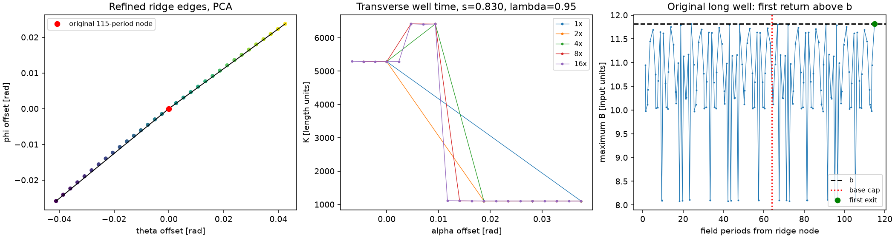

# M1 after accepted ADR 0001

This report continues the [initial evidence](README.md) under the researcher's
[accepted decision](../../adr/0001-long-well-cap-and-m1-ledger.md), commit
`692d3f740fec2aa32a5c5591f6f9d61b3eb841e8`. Earlier failed and incomplete results
remain preserved. This work computes trapped-well geometry and its population
ledger; connectivity and f begin at M3.

## Reproduction

Use the isolated environment and one equilibrium process at a time:

```bash
OPENBLAS_NUM_THREADS=1 MPLBACKEND=Agg .venv/bin/python scripts/validate_m1.py --output outputs/m1-final-base
OPENBLAS_NUM_THREADS=1 MPLBACKEND=Agg .venv/bin/python scripts/validate_m1.py --file PCA --transverse-tolerance .0025 --output outputs/m1-base-PCA-tight
OPENBLAS_NUM_THREADS=1 MPLBACKEND=Agg .venv/bin/python scripts/validate_m1.py --strip-rule simpson --transverse-tolerance .0025 --output outputs/m1-base-simpson
OPENBLAS_NUM_THREADS=1 MPLBACKEND=Agg .venv/bin/python scripts/survey_m1_long_wells.py --matrix --output outputs/m1-production-cached
OPENBLAS_NUM_THREADS=1 MPLBACKEND=Agg .venv/bin/python scripts/survey_m1_long_wells.py --matrix --file DMercFail --nodes 512 --output outputs/m1-dense-DMercFail
OPENBLAS_NUM_THREADS=1 MPLBACKEND=Agg .venv/bin/python scripts/survey_m1_long_wells.py --matrix --file d23p4 --nodes 512 --output outputs/m1-dense-d23p4
OPENBLAS_NUM_THREADS=1 MPLBACKEND=Agg .venv/bin/python scripts/validate_m1.py --file d23p4 --surfaces 48 --nodes 512 --volume-phi 4096 --transverse-tolerance .0025 --output outputs/m1-d23-tight
OPENBLAS_NUM_THREADS=1 MPLBACKEND=Agg .venv/bin/python scripts/check_m1_tail_ledgers.py
OPENBLAS_NUM_THREADS=1 MPLBACKEND=Agg .venv/bin/python scripts/probe_m1_long_wells.py
OPENBLAS_NUM_THREADS=1 MPLBACKEND=Agg .venv/bin/python scripts/plot_m1_long_strip.py
```

The base commands and the survey exit nonzero for retained
convergence misses. The exact production
source tree is commit `df18d9035c90d3590f088e4c73aa36167312035f`;
every recorded production source hash matches that commit. Later changes add
the stricter local-control option and promote verified defaults. Per-attempt
source hashes distinguish those measurements.

## Method

Base ridge chains are traced for 64 periods at 128 samples per period. Only
capped nodes are retraced, doubling to 128 and then 256 periods. Other rows are
preserved. Each row records its own traced limit; padding is NaN, not an
invented extremum. Derivative tables can be restored for the current surface
and are released afterward.

A well still capped at the ceiling retains unknown status and NaN full J/K.
Its separately accumulated partial K integrates the observed below-b part from
the incoming bounce to the trace ceiling, or to an observed outgoing bounce
before an unresolved exit maximum. It is a numerical estimate of a physical
lower-bound contribution. If no below-b portion was observed, the lower bound
can be zero; the full weight remains unknown. Failed quadratures remain failed.

Ridge edges adjacent to wells longer than 64 periods are refined by positive
dyadic quadrature, up to 16 times the chosen base density. Activity-boundary
edges are refined as population quadrature too. Every original node remains
in the grid. Auxiliary pitch-specific quadrature queries may stop once their
first exit is found; otherwise their short initial scans double through the
same ceiling. This does not change the base chain's 64-period rule.

Projection onto the ridge moves along the field line and preserves alpha.
The transverse measure includes the full winding seam. Fold endpoints have
H0=m0 and no strictly active starting well; refinement samples the adjacent arc.

### What convergence means

For each edge, take the magnitude of the change in resolved-plus-partial weight
between successive subdivision levels. Sum those magnitudes before radial
integration and source weighting. The full-slice estimate is

    E_h = integral ds h(sqrt(s)) sum_edges |delta w_edge|,

divided by the slice's resolved-plus-partial weight. Both sources must meet
their unchanged slice tolerance: 1% for DMercFail/d23p4 and 6% for the other
M1 fields. This comparison uses no volume-reference value. Positive source and
radial weights prevent cancellation between strips or surfaces.

Local surface changes, levels and any 16x ceiling are retained separately.
Local convergence is sufficient for any positive source, but the stipulated
slice test is source weighted. A small surface can reach its local ceiling
while contributing an acceptable absolute change to the full slice. This is
not a statement that its own relative change passed. None of these estimates
bound the unknown full weight of residual capped states.

The independent volume calculation uses B on angular slices, with theta roots
and endpoint substitutions. It uses no ridge, chain, K, partner or refined
strip weight. Its gap is reported, never used to fill missing contributions.

The local quadrature control can be stricter than the acceptance tolerance.
In particular, d23p4's final production check uses 0.25% local control while
retaining 1% acceptance. A 512-node run initially appeared to pass with 1024
phi slices, but its peaked-source lambda_n=0.95 ratio changed from 0.990147
to 0.989968 with 4096 phi slices. That result fails. Tightening ridge quadrature
at the same 16x ceiling gives 0.992346 against the finer reference. Both
estimates are retained; neither the ratio nor the tolerance was rounded.

Composite Simpson quadrature is an explicit alternative to trapezoids on the
same nested nodes. Both use positive coefficients, including for partial
lower-bound contributions. It also misses coarse-grid convergence and is
retained as an unsuccessful experiment, not the selected evidence. Base and
production results below use trapezoids. The original
24-surface/128-node trapezoid run misses PCA lambda_n=0.95 for the peaked
source: its last change is 7.12325%, or 6.62190% with tighter local control,
against 6% acceptance. Both remain failed convergence attempts. The Simpson check keeps
that base resolution, cap, refinement ceiling and acceptance. An independent
cubic/quadratic integral tests its nonconstant measure; the analytic 100-period
well checks the complete refinement path for both rules.

M1's named base-resolution ledger criterion is the ratio against the
independent integral. All 30 cases, both sources, meet its 6%/1% limits.
The adaptive stopping check is separately demonstrated at the declared
production density on those same 30 cases: 256 nodes per 2pi for PCA/TURBO/n3are
and 512 for DMercFail/d23p4. Every selected production matrix entry passes both
checks. In particular, PCA lambda_n=0.95 has a peaked-source change of 1.65810%
at production density, within 6%. We do not claim that its 128-node estimate
converged. Both checks remain mandatory for an accepted production estimate;
the driver still exits nonzero when either fails.

At production density, n3are lambda_n=0.5 reveals two residual capped nodes
at 256 periods. Its two source ledgers are **incomplete**, not finite passing
ratios. Under ADR 0001 their resolved-plus-partial-lower/reference values are
0.99442 (uniform) and 0.98166 (peaked), satisfying the required upper inequality.
Their transverse changes are 0.3964% and 0.4392%. The 58 other selected
production source checks have finite ratios. The base grid has no residual
capped node; its finite ledger closure does not exclude narrow unknown strips
revealed at higher density.

## Results

<!-- RESULTS -->
| File | lambda_n | Base h=1 / peaked | Production h=1 / peaked | Production nodes per 2pi |
| --- | ---: | --- | --- | ---: |
| PCA | 0.05 | 0.999405 / 1.005581 | 1.003243 / 1.003898 | 256 |
| PCA | 0.1 | 0.999898 / 1.000184 | 1.001233 / 1.000647 | 256 |
| PCA | 0.5 | 1.000641 / 1.001452 | 0.999870 / 0.998758 | 256 |
| PCA | 0.8 | 0.996820 / 0.993012 | 0.996592 / 0.985919 | 256 |
| PCA | 0.9 | 1.005337 / 1.007817 | 0.999061 / 0.991516 | 256 |
| PCA | 0.95 | 1.006439 / 1.023661 | 1.011025 / 1.033441 | 256 |
| TURBO | 0.05 | 0.995891 / 1.002103 | 1.000087 / 0.997431 | 256 |
| TURBO | 0.1 | 1.001872 / 1.006900 | 0.999501 / 0.998268 | 256 |
| TURBO | 0.5 | 0.999907 / 0.999646 | 1.000010 / 1.000041 | 256 |
| TURBO | 0.8 | 1.002140 / 1.002406 | 0.999204 / 0.997836 | 256 |
| TURBO | 0.9 | 0.998998 / 0.993126 | 1.002738 / 1.011068 | 256 |
| TURBO | 0.95 | 0.996745 / 0.993100 | 1.000635 / 1.004406 | 256 |
| DMercFail | 0.05 | 0.996970 / 0.996533 | 0.999778 / 0.999995 | 512 |
| DMercFail | 0.1 | 0.999389 / 0.997311 | 1.000395 / 1.001051 | 512 |
| DMercFail | 0.5 | 1.000630 / 1.001943 | 0.999909 / 0.999791 | 512 |
| DMercFail | 0.8 | 1.000174 / 0.999641 | 1.000011 / 1.000291 | 512 |
| DMercFail | 0.9 | 0.998977 / 1.000452 | 0.999941 / 0.999975 | 512 |
| DMercFail | 0.95 | 0.998144 / 0.993869 | 0.998943 / 0.996432 | 512 |
| d23p4 | 0.05 | 0.999221 / 0.997724 | 1.000144 / 1.000038 | 512 |
| d23p4 | 0.1 | 1.001562 / 1.000592 | 1.000043 / 1.000078 | 512 |
| d23p4 | 0.5 | 1.001052 / 1.004182 | 1.000300 / 1.000367 | 512 |
| d23p4 | 0.8 | 0.999010 / 1.003445 | 0.998777 / 0.996223 | 512 |
| d23p4 | 0.9 | 1.003379 / 1.002323 | 1.002066 / 1.001175 | 512 |
| d23p4 | 0.95 | 1.006574 / 1.000269 | 0.998240 / 0.992346 | 512 |
| n3are | 0.05 | 0.987946 / 0.963135 | 0.997610 / 1.000208 | 256 |
| n3are | 0.1 | 0.993237 / 0.972604 | 1.000947 / 0.999494 | 256 |
| n3are | 0.5 | 0.996561 / 0.994864 | incomplete / incomplete | 256 |
| n3are | 0.8 | 1.008460 / 1.020690 | 1.002160 / 1.005191 | 256 |
| n3are | 0.9 | 1.006985 / 1.014618 | 0.998949 / 1.007168 | 256 |
| n3are | 0.95 | 0.976608 / 0.967883 | 0.994965 / 1.006733 | 256 |

The full ratios, errors and capped/failed counts are in [adaptive-matrix.csv](adaptive-matrix.csv), including the superseded production estimates. The base matrix meets the ledger-ratio criterion; its retained PCA .95 peaked convergence miss is resolved at production density. All selected results here use trapezoids. The final production d23p4 matrix uses local control 0.25%, 4096 phi slices and unchanged 1% acceptance. Other production matrix entries use the survey controls below.
<!-- /RESULTS -->

## Long-well survey and the future budget

The production survey covers lambda_n=0.40,0.41,...,0.99, matching the decision's
diagnostic window. The six required diagnostic levels are also evaluated;
0.05/0.1 are outside the integrated survey window. Geometry uses 48+4 radial
surfaces and the declared 256- or 512-node production option. The independent
ledger repeat uses 1024 phi slices, separately from the ridge discretization.

Each survey column integrates Q(b)/b² over that window, with both sources.
Tail percentages use the resolved window integral as their denominator.
Residual capped contributions are partial-weight lower bounds. The report
compares them with the literal 0.5% of V_h budget and also records normalization
by 2 V_h, the metric's total-birth denominator.

A lower bound below the budget cannot certify an upper-weight budget. This
partial pitch window also omits contributions elsewhere. Budget compliance and
the wildcard effect on connectivity remain M3 work; no small-tail argument is
used to certify f or its bracket here.

<!-- SURVEY -->
| File | Resolved tail >64 periods, h=1 / peaked [%] | Residual partial lower bound / V_h, h=1 / peaked [%] | Capped pitches | Slice convergence failures | Time [s] | RSS high-water [GB] |
| --- | ---: | ---: | ---: | ---: | ---: | ---: |
| PCA | 0.2629 / 0.1913 | 0.018682 / 0.009280 | 5 | 0 | 378.8 | 0.677 |
| TURBO | 0.1789 / 0.0525 | 0.025398 / 0.001471 | 2 | 0 | 289.8 | 0.726 |
| DMercFail | 0.0630 / 0.0101 | 0.002778 / 0.000000 | 1 | 1 | 438.9 | 0.689 |
| d23p4 | 0.1015 / 0.1746 | 0.001587 / 0.000000 | 1 | 1 | 421.8 | 0.691 |
| n3are | 0.3897 / 0.8119 | 0.019024 / 0.065169 | 1 | 0 | 363.8 | 0.743 |

Full sampled-pitch data, including the retained 256-node attempts, are in [adaptive-survey.csv](adaptive-survey.csv). Raw checks and active snapshots are in [adaptive-provenance.json](adaptive-provenance.json).
<!-- /SURVEY -->

The 256-node sweep has five pitch-slice convergence misses in DMercFail and
d23p4. Repeating those entire surveys at 512 nodes removes three. At
lambda_n=0.99 the uniform-source change still reaches 1.31985% for DMercFail
and 1.33422% for d23p4, above their 1% gate at the 16x ceiling. There are 14
and 19 residual capped quadrature nodes, respectively. These samples are
**unconverged diagnostics**, not accepted estimates of full population weight.
The survey drivers exit nonzero and retain every miss. No failed quadrature
occurred. The six named M1 pitches are judged separately in the matrix above;
the lambda_n=0.99 tail limitation remains for M3/M4.

All five surveys reach the 256-period ceiling. Extension time includes
auxiliary queries inside refinement time, so those two columns in the provenance
must not be added as disjoint costs. The partial lower-bound fractions in the
table are below 0.5% of V_h, but they do not certify the new M3 budget.

## Independent checks, retained failures and runtime scope

The four original capped nodes have first returns at about 73.8003, 114.8438,
99.6906 and 99.6905 periods. All preceding sampled maxima and the exit are
checked against direct Fourier-series roots. Scans at 128/512 samples per
period agree on the physical exit; orders 32/64 check composite quadrature.
See [the four-node probe](adaptive-long-wells.json).

The first adaptive base run reported closure of all 30 cases using the earlier
convergence diagnostic; it is not the final acceptance evidence. Subsequent
checks preserved two implementation lessons: edge errors must be added in magnitude before
summing strips, and convergence must be assessed on the full source-weighted
slice while retaining local ceiling diagnostics. The stopped sweeps are
preserved as attempts, not presented as complete validation.

The survey driver evaluates pitches surface by surface, retaining temporary
derivative tables only for that surface. All 62 common PCA evaluations match
the earlier pitch-major driver's weights, statuses and refinement factors
exactly. This changes table reuse, not numerical controls or physics.

Five reverted mutations made independent tests fail: remove the seam; omit
1/B from arc length; flip sign(C); treat a capped well as inactive/passing;
and allow opposite strip errors to cancel. The clean local suite and final
GitHub checks are recorded below.

<!-- CHECKS -->
`make check`: Black clean, 32 tests passed; full-tier process 8.27 s / 300 s.
`make test`: 32 passed; fast-tier process 9.92 s / 120 s; largest test 4.94 s.
Both use three pytest workers. `make smoke`: clean isolated install/import passed.
Final GitHub Tests and the requested Claude review are recorded on
[PR #1](https://github.com/landreman/alpha_analysis_3/pull/1).
<!-- /CHECKS -->

All equilibrium runs are sequential with one worker and
OPENBLAS_NUM_THREADS=1. The watchdog uses process resident high-water memory
and aborts above 2 GB. Active 60/180/300-second snapshots, source/data hashes,
controls, actual global b and extrema are in the provenance. Python imports
precede per-file timing; numerical setup and queries are included, while
diagnostic figure rendering is separate in the survey timing. No JIT kernels
or compilation cache are used.

These are ledger and diagnostic-sweep timings, not complete f or N-vs-2N
runtime acceptance. The Python/SciPy implementation still needs substantial
optimization for M5; M3 must first assess coverage, connectivity and the bracket.

## Diagnostic

The left panel shows the dyadic nodes on two ridge edges around the original
115-period PCA well. The middle panel shows how a coarse node can spread a
large K over too much transverse measure. The right panel verifies the first
return above b lies beyond the old cap.


