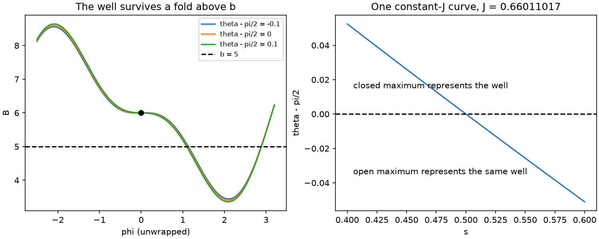

# M2: transitions and ridge-cell coverage

M2 is **blocked**, with [PR #2](https://github.com/landreman/alpha_analysis_3/pull/2)
left draft and [ADR 0002](../../adr/0002-fold-well-identity.md) proposed for a
researcher decision. The acceptance row in STATUS remains unchecked. These
records retain the initial failures; they do not claim a completed milestone,
connectivity, Q(b), f, or the final accuracy/runtime target.

The baseline is `27f251d37a3ddd64784f5cead2d68a5563ba88a0`, with green
[GitHub Tests](https://github.com/landreman/alpha_analysis_3/actions/runs/43065702135).
The five exact manifest files, global extrema and six conserved bounce fields
are used throughout. Both sources are reported separately.

## Blocking counterexample: a fold need not kill the well

The current candidate's zero/inactive fold endpoint policy is false. In the
explicit field B=6+(-2+0.5 cos(theta)) sin(phi)+sin(2 phi), iota=0 and b=5,
an open maximum disappears at theta=pi/2 while its outgoing well remains
finite: J=0.6601101743548781, K=4.1614783045408625 at s=0.5 and C=3.3.
The preceding closed maximum takes over representation of the same well.
The independently integrated constant-J curve crosses this boundary. There
is no interior barrier event and both T and Gamma_max counts are zero locally.

The [independent diagnostic](../../../scripts/probe_m2_fold_identity.py)
uses analytic bounce roots and QUADPACK, not the production field evaluator
or well quadrature, for its oracle. Its [full result](fold-identity.json)
also preserves the uniform-chain scan defect: a narrow preceding max/min
pair is missed, making two maxima represent the same active well. Increasing
128 to 512 samples repairs one offset but fails closer to the fold; 4096
resolves the listed counterexample, not arbitrary fold approaches.



The same diagnostic finds finite one-sided fold limits in n3are at
s=0.7922826086956523 for lambda_n=0.1, 0.5 and 0.8. These are not repaired
population totals or strict maxima at the degenerate point. The
[projection summary](fold-projection-summary.json) records 50 problematic
endpoint samples on the 96-surface n3are grid, including 20 base nodes with
positive exact curvature. Direct along-line Newton projection with exact
Fourier derivatives does not repair them. Both the projection defect and
well-identity defect need correction; neither is an acceptable zero fill.

The proposal keeps the ridge/well formulation and adds ordinary same-J
continuation when a well's representative changes, with root/identity
verification and explicit unknown incidence on failures. The scientific
decision is whether to accept or revise that state-space clarification and
its new acceptance checks. Population weight alone cannot certify the
connectivity through a boundary. No gate or scientific input is relaxed.

## Implementation and independent checks

- `transitions.py` requires the short exit to occur inside the long well's
  chain. It bisects the edge, evaluates the two finite banks and independently
  traces the other child from the interior maximum. The additivity residual
  must be at most 2e-6 relative; event-coordinate brackets are at most 1e-8.
  A finite-action fallback does not repair a failed time integral or its status.
- The synthetic two-well field has analytically known transition coordinates
  and independently integrated actions. The legacy DMercFail event is found at
  its recorded actual b, with its recorded parent action. Smooth bounce-point
  motion is not a transition. A three-well crossing forces cell subdivision.
- `cells.py` matches both directions, scales the partner distance with density,
  and triangulates strips with unequal node counts. Integer vertex IDs,
  parent-face IDs, cut-edge flags and shared transition locations are retained.
  One-/three-cut cells subdivide; residual cells stay unknown.
- Open arcs are oriented before stitching. Generic fold endpoints are polished
  on the exact Fourier series using D_parallel B = D_parallel² B = 0 and a
  nonzero third derivative. Resolved fold end strips are included as cells;
  failed or degenerate folds remain frontier. An analytic fold model recovers
  the full area 3 pi Delta s, including a reversed top arc.
- The M2 population check assigns each surface-edge integral once to its
  incident radial boundary triangle, with positive Delta s/2 weights. Unmeshed
  frontiers remain in the ledger. It uses no independent-volume gap to fill
  missing population. M3 still needs clipped cell weights with interior K
  nodes; this boundary rule is not a claim about within-cell loss weights.
- The independent cosine-field line integral checks cell-ledger normalization.
  Capped full weights remain unknown; partial-K contributions are lower bounds.

## Preserved first attempts

The [initial census](base-census-factor4.csv) evaluates all 840 combinations
of 28 surfaces and the 30 manifest/pitch cases. It uses 128 nodes per 2 pi,
512² tables, order 32 and up to fourfold edge refinement. Twenty-eight
surfaces retain count, assignment or localization uncertainty. The controls,
source hashes, resource records and raw-report hash are in
[initial-census-provenance.json](initial-census-provenance.json).

The [initial coverage sweep](coverage-initial.csv) uses up to 64 adaptive
surfaces and the same node density. All 30 cases and both sources are retained,
including every miss of the 1% ledger, 0.5% frontier or 1% transverse-change
criteria. The [provenance](coverage-initial-provenance.json) records the exact
controls and active snapshots. This attempt preceded open-arc orientation and
polished fold-strip repair. In particular, PCA lambda_n=0.05 has partnered
nodes but 1.42% peaked-source weight in the omitted fold end strips. Adding
radial surfaces cannot repair those angular gaps.

The initial PCA 0.95 transverse change is 6.62% for the peaked source. This
remains a failed estimate. Its population excess must be separated from
independent angular-reference error by refinement; it is not attributed to
missing coverage alone.

## Provisional PCA evidence

The [refinement table](PCA-refinements.csv) retains the 256-, 512- and
1024-node attempts and their [provenance](PCA-refinement-provenance.json).
Polished fold strips remove the measured low-pitch geometric gap under the
candidate endpoint policy; ADR 0002 prevents accepting its population result.
Prioritizing
active-state measure avoids spending the radial insertion budget on surfaces
inactive at all six diagnostic pitches; the earlier
[stopped setup](stopped-setup.json) remains recorded. This priority changes no
ledger weight or unknown-state classification.

At 256 nodes all six PCA cases numerically meet 1% ledger closure and 0.5% frontier
coverage for both sources. Lambda_n=0.95 still misses transverse convergence:
3.06% peaked-source change. At 512 nodes it is 1.38%, still a failure. At
1024 nodes it is 0.8792% (uniform 0.3632%). The selected 1024-node ratios are
0.999033 and 0.999260, with zero measured frontier weight. This isolated
refinement uses the same global b, 28-surface grid, 256-period ceiling and
16x local-refinement ceiling. Its resident high-water is 0.846 GB; total
time is 434.5 s, including 385.3 s pitch-independent setup. It is not full-f
or runtime acceptance. Its configurable chain allocation cap was 1 GiB;
retained chains at completion occupy 192.4 MB.

The independent reference uses 2048 phi slices and fourfold theta sampling
of the 512² interpolant. A separate fixed-ridge-weight reference probe varies
these directions independently. A Fourier-Hessian extremum bound skips
surfaces whose field is everywhere above b. The subgrid-minimum regression
ensures this shortcut retains a narrow trapped population missed by the FFT
grid's sampled minimum.

## All 30 candidate cases, retained without certification

[coverage-candidate.csv](coverage-candidate.csv) contains 60 source checks:
six global pitches on each of the five manifest files, with uniform and
peaked sources. The [provenance](coverage-candidate-provenance.json) records
each raw report's SHA256, revision, controls, source hashes, timing and memory.
The selected PCA 0.95 row uses the 1024-node attempt; the other selected rows
use 256 nodes. All earlier attempts remain in the files above.

Forty-eight checks numerically meet the candidate ratio, frontier and
transverse screens. None is certified as M2 acceptance because the fold
endpoint rule and possible duplicate identities are unresolved. All 12
n3are source checks are incomplete: six pitches have 630 failed auxiliary
points, except lambda_n=0.5 with 631. Full population ratios remain NaN.
At lambda_n=0.8 even the known peaked-source ratio is 1.0100059524, slightly
outside 1%; it remains a failure without rounding.

The final incident-face propagation correction makes every triangle incident
to an unpartnered vertex unknown, including weight on its opposite boundary.
Its focused regression passes. The saved sweep's frontier columns predate
that correction and are labelled accordingly; no updated passing coverage
claim is inferred from them. A new full sweep is deferred until the fold
contract is decided and implemented.

The initial factor-four census is not the required final 16x census. The
all-30 complete cut-cell plots, final additivity/count/coverage gates and
controlled independent-reference refinement remain outstanding. No M3
reachability, loss bracket, f or final runtime acceptance is claimed. The
isolated PCA setup/refinement already exceeds 300 s on this host; the present
implementation has not demonstrated a feasible full-f runtime. A denser
uniform scan alone cannot resolve this topology issue or certify roots.

## Software checks and mutations

On the final candidate, `make check` passes formatting and all 55 full-tier
tests (12.42 s pytest time, 12.93 s driver wall time, three workers). The
isolated `make smoke` install/import check passes. These are software checks;
the scientific failures above remain blockers.

The [mutation record](mutations.json) preserves three intentionally red
checks: bypassing the interior-barrier test accepts smooth bounce motion;
skipping bisection fails split/merge additivity; removing reverse partners
fails unequal-node strip coverage. Each modified source file is restored
byte for byte (SHA256 recorded), and the four affected parametrized tests
pass afterward. The reverse-partner mutation was exercised on the synthetic
coverage regression; the required final real-input n3are mutation/coverage
acceptance remains outstanding with the blocked numerical suite.

## Reproduction

Run from an installed clean environment, one equilibrium at a time:

```bash
OPENBLAS_NUM_THREADS=1 OMP_NUM_THREADS=1 python scripts/validate_m2.py \
  --output outputs/m2/transitions.json
OPENBLAS_NUM_THREADS=1 OMP_NUM_THREADS=1 python scripts/validate_m2_coverage.py \
  --nodes 256 --volume-phi 2048 --cut-probe --plots outputs/m2/plots \
  --output outputs/m2/coverage.json
OPENBLAS_NUM_THREADS=1 OMP_NUM_THREADS=1 python scripts/probe_m2_fold_identity.py \
  --output outputs/m2/fold-identity.json --plot outputs/m2/fold-identity.png
```

The drivers enforce a 2 GB resident-memory watchdog, retain active
60/180/300-second snapshots and exit nonzero on unresolved acceptance checks.
Full raw records and larger artifacts stay outside Git.
